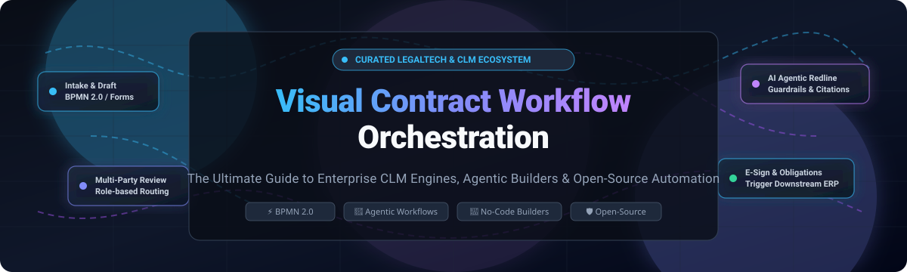

# 📜 Awesome Visual Contract Workflow Orchestration ⚡

  <strong>A curated list of top Visual Contract Workflow Orchestration platforms — both enterprise SaaS/Hosted commercial solutions and open-source alternatives for designing, automating, and orchestrating contract lifecycle processes with visual drag-and-drop builders.</strong>

  
  
  
  
  
  

---

  🌟 <strong>Star this repo if you find it useful!</strong> 🌟

---

## 📑 Table of Contents

- [🌐 Sector Overview & Market Dynamics](#-sector-overview--market-dynamics)
- [🟦 SaaS / Hosted Commercial Platforms](#-saas--hosted-commercial-platforms)
- [🟩 Open-Source Software](#-open-source-software)
- [📊 Feature Comparison at a Glance](#-feature-comparison-at-a-glance)
- [📈 Star History](#-star-history)
- [🤝 Contributing](#-contributing)
- [💖 Support](#-support)
- [📄 License](#-license)

---

## 🌐 Sector Overview & Market Dynamics

The global Contract Lifecycle Management (CLM) software market is estimated at **$1.7B – $2.1B** and is projected to expand to **$4.6B – $6.2B** over the next decade (growing at ~11–13% CAGR), while adjacent workflow orchestration and contract process automation software represent an addressable market exceeding **$5B to $25B+**. The sector remains **moderately to highly fragmented**—characterized by a split between legacy enterprise ERP/ITSM ecosystems, high-growth dedicated AI-native CLM vendors, and modular BPMN orchestration engines—rather than a single "winner-take-all" incumbent, creating immense demand for visual orchestration layers that unify cross-departmental legal, sales, and procurement workflows.

---

## 🟦 SaaS / Hosted Commercial Platforms

Commercial, cloud-hosted Visual Contract Workflow Orchestration platforms. The table below is sorted in descending order by enterprise company size (market capitalization / valuation / annual revenue).

| 🏢 Platform | 💰 Company Size (Valuation / Revenue) | 🏷️ Starting Pricing | 🎁 Free Tier / Trial Limit | 🛠️ Visual Builder & Contract Workflow Focus |
|---|---|---|---|---|
| **Microsoft Power Automate** | **~$3.1 Trillion** market cap (Microsoft) / >$245B annual revenue | **$15 / user / month** (billed annually for Power Automate Premium) | **90-day free trial** with full attended RPA & Premium connectors (basic cloud flows included with M365 licenses) | Visual low-code flow designer for intake, Teams adaptive card approvals, SLA expiration alerts, and Dynamics/SharePoint contract processing. |
| **ServiceNow Flow Designer** | **~$115 Billion+** market cap / >$10B annual revenue | **~$70 - $200+ / fulfiller seat / month** (packaged with ITSM/CSM platform contracts; IntegrationHub transactions metered separately) | **Free developer personal instance (PDI)** at developer.servicenow.com (subject to 10-day inactivity reclaim limit) | Natural-language and low-code drag-and-drop Flow Designer automating renewal task generation, contract state changes, and ERP system triggers. |
| **Ironclad Workflow Designer** | **$3.2 Billion** valuation (Series E) / >$140M - $200M ARR | **~$25,000 / year** (entry mid-market tier; custom annual quote based on user seats and contract volume) | **14-day guided proof-of-concept / sandbox trial** upon sales qualification (no self-serve free forever plan) | Drag-and-drop Workflow Designer for intake launch forms, dynamic conditional clause assembly, counterparty redlining, and approval hierarchies. |
| **Icertis Agent Studio** | **~$2.8B - $5.0 Billion** valuation / >$300M ARR | **~$100,000 / year** (enterprise annual subscription based on contract volume and author/approver roles) | **Custom 30-day enterprise sandbox evaluation** for qualified enterprise POCs (no public free tier) | Agent Studio visual orchestration environment chaining autonomous AI Vera Agents (Composer, Insights, Fulfillment) with strict enterprise guardrails. |
| **Nintex Workflow Cloud** | **>$2.0 Billion** valuation (TPG acquisition) / >$250M ARR | **~$15,000 / year** (~$1,250/mo entry tier including DocGen and workflow instances) | **30-day free trial** with full access to workflow builder, document generation, and digital forms | End-to-end visual workflow builder for legal intake forms, automated routing, document generation (DocGen), and electronic signature orchestration. |
| **Camunda** | **>$1.0 Billion** valuation (Unicorn) / ~$200M ARR | **~$50,000 / year** (Enterprise production license); Free self-managed developer tier available | **30-day free cloud trial** of full process execution; Free-forever tier limited to collaborative modeling & non-production testing | BPMN 2.0 & DMN visual process orchestration modeler for decoupled, high-throughput smart contract pipelines and enterprise obligations. |

---

## 🟩 Open-Source Software

Self-hosted, community-driven Visual Contract Workflow Orchestration and legal automation projects. Sorted in descending order by GitHub star count.

| 📦 Project | ⭐ Stars | 📜 License | 💻 Tech Stack | 🔍 Key Contract & Workflow Orchestration Capabilities |
|---|---|---|---|---|
| [**n8n**](https://github.com/n8n-io/n8n) |  | Sustainable Core (Fair-code) | TypeScript / Node.js | Fair-code visual node-based workflow builder with 400+ connectors, AI agent nodes, and webhooks to orchestrate contract intake, webhook signatures, and ERP synchronization. |
| [**Flowise**](https://github.com/FlowiseAI/Flowise) |  | Apache-2.0 | TypeScript / React | Drag-and-drop visual UI for building LLM orchestration chains and agentic workflows; ideal for AI contract extraction, clause Q&A, and redlining routing. |
| [**Activepieces**](https://github.com/activepieces/activepieces) |  | MIT / Open-Core | TypeScript / Angular | Open-source visual workflow automation platform with modular pieces for DocuSign, PDF generation, Google Drive, and automated multi-tier approval flows. |
| [**Automatisch**](https://github.com/automatisch/automatisch) |  | AGPL-3.0 | JavaScript / React | Self-hosted visual zap-style automation alternative that keeps sensitive legal documents within your internal perimeter while routing contracts through approval stages. |
| [**Camunda Community Engine**](https://github.com/camunda/camunda) |  | Apache-2.0 (v7 Core) | Java / TypeScript | Enterprise-grade visual BPMN 2.0 process modeling engine used to execute deterministic contract state machines, SLA escalation timelines, and obligations. |
| [**General Legal Templates**](https://github.com/General-Legal/legal-templates) |  | CC0-1.0 | Markdown / Legal | Attorney-drafted open collection of modular contract templates (MSA, DPA, NDAs) formatted specifically for programmatic templating engines and LLM workflows. |
| [**OpenContracts**](https://github.com/Open-Source-Legal/OpenContracts) |  | Apache-2.0 | Python / Django / React | Open-source document intelligence and contract analysis platform for parsing, annotating, structuring, and extracting citation graphs across legal corpuses. |
| [**Docassemble**](https://github.com/jhpyle/docassemble) |  | MIT | Python / YAML / Docker | Open-source expert system for guided contract interviews, automated document assembly, and rule-based legal logic workflows. |
| [**ProcessMaker Core**](https://github.com/processmaker/processmaker) |  | AGPL-3.0 | PHP / Vue.js | Low-code BPM and visual workflow suite featuring drag-and-drop form builders, task routing, and approval logic for legal operations. |
| [**Accord Project Cicero**](https://github.com/accordproject/cicero) |  | Apache-2.0 | TypeScript | Open-source framework for smart legal contracts that links computable clause logic and data models to visual contract generation pipelines. |
| [**draft-legal**](https://github.com/AniketTati/draft-legal) |  | AGPL-3.0 | TypeScript / Python | AI-native open-source CLM alternative to Ironclad and Harvey with self-hosted Docker deployment, agent-first redlining, and multi-step approval workflows. |
| [**SHAR Workflow Engine**](https://gitlab.com/shar-workflow/shar) |  | Apache-2.0 | Go / NATS | Lightweight, high-performance BPMN workflow engine written in Go and backed by NATS.io to execute Camunda-modeled contract processes with zero DB overhead. |

---

## 📊 Feature Comparison at a Glance

| 🛠️ Platform | 🏷️ Type | 🎨 Visual Builder | 📝 Contract Specificity | 🏠 Self-Hosted | 🎯 Best For |
|---|---|---|---|---|---|
| **Microsoft Power Automate** | Commercial SaaS | Low-Code Flow Studio | ⚠️ Pattern / Connector based | ❌ Cloud only | Enterprise M365 / Dynamics contract approvals |
| **ServiceNow Flow Designer** | Commercial SaaS | Low-Code Drag & Drop | ⚠️ Requires workflow configuration | ❌ Cloud only | Enterprise IT/HR/Vendor contract lifecycle tasks |
| **Ironclad Workflow Designer** | Commercial SaaS | No-Code Drag & Drop | ✅ Dedicated CLM | ❌ Cloud only | Legal & ops teams seeking turnkey self-serve CLM |
| **Icertis Agent Studio** | Commercial SaaS | Agentic Visual Studio | ✅ Dedicated CLM + AI Agents | ❌ Cloud only | Large Global 2000 enterprises requiring AI agent governance |
| **Nintex Workflow Cloud** | Commercial SaaS | Visual Flow Canvas | ✅ CLM & DocGen patterns | ❌ Cloud only | Document generation, intake forms & e-sign flows |
| **Camunda Platform** | SaaS / Commercial Core | BPMN 2.0 & DMN Modeler | ⚠️ General process engine | ✅ (v7 / Self-managed) | Complex, multi-system enterprise orchestration |
| **n8n** | Fair-code OSS | Node-Based Visual Canvas | ⚠️ General process engine | ✅ Self-hostable | Flexible API-driven contract automation & AI agents |
| **Flowise** | Open-Source | Drag & Drop Nodes | ⚠️ Agentic LLM framework | ✅ Self-hostable | Visual AI-powered clause review & legal chatbot chains |
| **Activepieces** | Open-Source | Visual Flow Canvas | ⚠️ General process engine | ✅ Self-hostable | Lightweight no-code legal approvals and PDF automations |
| **Automatisch** | Open-Source | Visual Flow Builder | ⚠️ General process engine | ✅ Self-hostable | Privacy-focused on-premise contract trigger workflows |
| **OpenContracts** | Open-Source | Annotation & Extraction UI | ✅ Dedicated Legal / Contract | ✅ Self-hostable | Open document intelligence, clause analysis & citations |
| **Docassemble** | Open-Source | Guided Interview Builder | ✅ Dedicated Legal / Contract | ✅ Self-hostable | Legal intake interviews & dynamic contract document generation |
| **ProcessMaker Core** | Open-Source | BPMN Visual Canvas | ⚠️ General process engine | ✅ Self-hostable | Departmental review, sign-off & request ticket workflows |
| **Accord Project Cicero** | Open-Source | Template Engine | ✅ Dedicated Legal / Contract | ✅ Self-hostable | Computable smart legal clauses & automated agreements |
| **draft-legal** | Open-Source | Chat & Workflow Routing | ✅ Dedicated CLM | ✅ Self-hostable | Privacy-conscious teams wanting self-hosted AI CLM |
| **SHAR** | Open-Source | Camunda XML Execution | ⚠️ General BPMN engine | ✅ Self-hostable | Go engineers requiring high-throughput BPMN orchestration |

---

## 📈 Star History

---

## 🤝 Contributing

Contributions, suggestions, and corrections are warmly welcomed! 💡

To contribute:
1. 🍴 Fork this repository.
2. 🌿 Create a descriptive branch (`git checkout -b add-new-contract-tool`).
3. ✍️ Add the tool in alphabetical or sorted order with project URL, star badge, license, and key capabilities.
4. 🚀 Open a Pull Request detailing why the project qualifies as a visual contract workflow tool.

Please ensure that open-source projects are actively maintained and feature either visual workflow builders, contract templating engines, or legal process orchestration capabilities.

---

## 💖 Support

Thank you for visiting and supporting the **Awesome Visual Contract Workflow Orchestration** list! 🌟

If you found this compilation useful, please consider:
- ⭐ **Starring** this repository to help others discover it.
- 🍴 **Forking** the project and contributing your own insights.
- 📢 **Sharing** this guide with colleagues, legaltech enthusiasts, and automation engineers.
- ☕ **Sponsoring** the maintainer on the [GitHub Sponsors Dashboard](https://github.com/sponsors/ishandutta2007) to help support continuous curation and updates!

---

## 📄 License

This compilation is released under the creative [CC0 1.0 Universal (Public Domain)](LICENSE). Individual software projects listed retain their respective licenses and trademarks.
